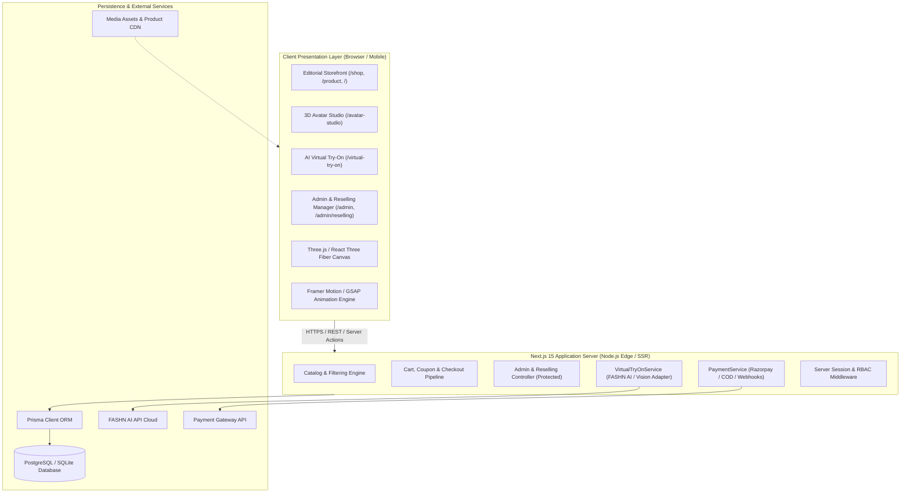

# XEVORAS — System & Technical Architecture
**Architecture Standard:** Enterprise Next.js 15 Full-Stack · Headless Commerce · 3D WebGL · AI Vision Integration

---

## 1. High-Level Architecture Topology



---

## 2. Directory & Modular Organization

```
xevoras-platform/
├── app/                               # Next.js 15 App Router
│   ├── (storefront)/                  # Public customer browsing group
│   │   ├── page.tsx                   # Cinematic editorial homepage
│   │   ├── shop/                      # Catalog & multi-facet filters
│   │   ├── product/[slug]/            # Rich product detail page
│   │   ├── women/                     # Women's editorial collection
│   │   ├── men/                       # Men's editorial collection
│   │   ├── the-edit/                  # Curated styling edits
│   │   ├── cart/                      # Shopping bag overview
│   │   ├── checkout/                  # Address, coupons & payment
│   │   ├── account/                   # Customer dashboard & order history
│   │   ├── wishlist/                  # Synced customer wishlist
│   │   ├── size-guide/                # Interactive measurement charts
│   │   └── legal/                     # Privacy, terms, shipping, returns
│   ├── avatar-studio/                 # Signature 3D Avatar Customizer
│   │   └── page.tsx
│   ├── virtual-try-on/                # AI Virtual Try-On Studio
│   │   └── page.tsx
│   ├── admin/                         # Staff control centre
│   │   ├── page.tsx                   # Executive analytics & overview
│   │   ├── products/                  # Product & variant management
│   │   ├── orders/                    # Order fulfilment desk
│   │   ├── reselling/                 # Meesho reselling manager
│   │   └── cms/                       # Homepage & banner manager
│   └── api/                           # Secure backend endpoints
│       ├── try-on/                    # VirtualTryOnService proxy
│       ├── checkout/                  # Order placement & validation
│       ├── products/                  # Filtered catalog API
│       └── admin/                     # Protected CRUD operations
├── components/                        # Reusable React components
│   ├── ui/                            # Atoms: Buttons, Inputs, Modals, Badges
│   ├── layout/                        # Header, Navigation, CartDrawer, Footer
│   ├── storefront/                    # ProductCard, Gallery, Hero, Filters
│   ├── avatar/                        # 3D Canvas, Mannequin, Garments, Controls
│   ├── try-on/                        # PhotoUpload, ModelPicker, SliderCompare
│   └── admin/                         # MetricCards, OrderTable, ResellMarginCalculator
├── lib/                               # Business logic & services
│   ├── db/                            # Prisma client & database queries
│   ├── services/
│   │   ├── try-on.service.ts          # Provider-agnostic AI try-on adapter
│   │   ├── payment.service.ts         # Payment gateway abstraction
│   │   ├── margin.service.ts          # Reselling economics calculator
│   │   └── catalog.service.ts         # In-memory & DB catalog normalization
│   └── utils/                         # Currency formatting, validation, tokens
├── prisma/                            # Database schema & migrations
│   └── schema.prisma
├── public/                            # Static assets
│   ├── brand/                         # Official XEVORAS gold logo & emblem
│   └── media/                         # Curated product photography & 3D models
└── design-system/                     # UI/UX Pro Max tokens & documentation
```

---

## 3. Core Service Abstractions

### 3.1 VirtualTryOnService Interface
To prevent vendor lock-in and secure API credentials server-side, all AI try-on operations route through a provider-independent contract:

```typescript
export interface TryOnRequest {
  userImageBase64: string;
  clothingImageUrl: string;
  category: 'tops' | 'bottoms' | 'one-pieces';
  mode: 'fast' | 'quality';
  userId?: string;
}

export interface TryOnResult {
  jobId: string;
  status: 'pending' | 'processing' | 'completed' | 'failed';
  resultImageUrl?: string;
  error?: string;
  provider: 'fashn-ai' | 'simulation-demo';
}

export interface IVirtualTryOnProvider {
  submitTryOn(req: TryOnRequest): Promise<TryOnResult>;
  checkStatus(jobId: string): Promise<TryOnResult>;
}
```

### 3.2 PaymentService Abstraction
```typescript
export interface PaymentOrderIntent {
  orderId: string;
  amountPaise: number;
  currency: 'INR';
  customer: { name: string; email: string; phone: string };
  method: 'prepaid' | 'cod';
}

export interface IPaymentProvider {
  createIntent(intent: PaymentOrderIntent): Promise<{ intentId: string; clientSecret?: string }>;
  verifyWebhook(payload: any, signature: string): Promise<boolean>;
}
```

---

## 4. Security & Compliance Architecture

1. **Server-Side Verification:** Price and inventory verification occur exclusively on the server at `/api/checkout`. Client-side prices are never trusted.
2. **Encrypted Admin Sessions:** Admin authentication is backed by HTTP-only secure session cookies with JWT verification and Role-Based Access Control (RBAC).
3. **Privacy by Design for AI Try-On:**
   - Ephemeral photo processing: Customer photos are stored temporarily in volatile memory or isolated short-lived buckets.
   - Deletion hooks: Uploads are purged upon generation or within 24 hours.
   - User consent: Mandatory checkbox agreeing to image processing before any upload is dispatched.
4. **Third-Party Marketplace Isolation:**
   - Zero scraping of Meesho or external vendor sites.
   - Sourcing data is ingested via sanitized manual input forms and verified CSV uploads with rigorous schema validation.
