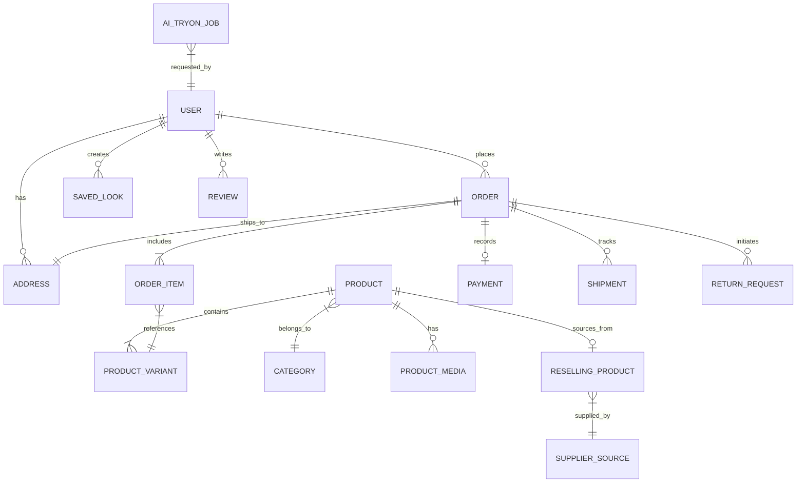

# XEVORAS — Normalized Database Schema & Data Models
**Engine:** Prisma ORM with SQLite / PostgreSQL compatibility  
**Standard:** ACID-compliant, Transaction-Safe, Normalized 3NF

---

## 1. Schema Entity Relationship Overview



---

## 2. Prisma Schema Definition (`prisma/schema.prisma`)

```prisma
datasource db {
  provider = "sqlite" // Seamlessly switchable to "postgresql" via DATABASE_URL
  url      = env("DATABASE_URL")
}

generator client {
  provider = "prisma-client-js"
}

// -------------------------------------------------------------
// Authentication & User Management
// -------------------------------------------------------------

enum Role {
  CUSTOMER
  STAFF
  ADMIN
  SUPER_ADMIN
}

model User {
  id            String    @id @default(cuid())
  email         String    @unique
  passwordHash  String?
  name          String?
  phone         String?
  role          Role      @default(CUSTOMER)
  createdAt     DateTime  @default(now())
  updatedAt     DateTime  @updatedAt

  addresses     Address[]
  orders        Order[]
  savedLooks    SavedLook[]
  reviews       Review[]
  aiJobs        AITryOnJob[]
  auditLogs     AuditLog[]
}

model Address {
  id            String    @id @default(cuid())
  userId        String?
  name          String
  phone         String
  line1         String
  line2         String?
  city          String
  state         String
  pincode       String
  country       String    @default("India")
  isDefault     Boolean   @default(false)
  createdAt     DateTime  @default(now())

  user          User?     @relation(fields: [userId], references: [id], onDelete: Cascade)
  orders        Order[]
}

// -------------------------------------------------------------
// Catalog, Products & Inventory
// -------------------------------------------------------------

enum Gender {
  WOMEN
  MEN
  UNISEX
}

enum ProductStatus {
  DRAFT
  PUBLISHED
  ARCHIVED
}

model Category {
  id            String    @id @default(cuid())
  name          String
  slug          String    @unique
  description   String?
  gender        Gender
  imageUrl      String?
  sortOrder     Int       @default(0)
  createdAt     DateTime  @default(now())
  updatedAt     DateTime  @updatedAt

  products      Product[]
}

model Product {
  id                 String         @id @default(cuid())
  name               String
  slug               String         @unique
  description        String
  shortDescription   String?
  gender             Gender
  pricePaise         Int            // Base selling price in INR Paise (e.g. 489000 = ₹4,890)
  compareAtPricePaise Int?          // Strikethrough MSRP
  material           String?
  fit                String?
  pattern            String?
  careInstructions   String?
  keywords           String?
  status             ProductStatus  @default(PUBLISHED)
  featured           Boolean        @default(false)
  isNewArrival       Boolean        @default(false)
  categoryId         String
  sourcingType       String         @default("OWN") // "OWN" or "ON_DEMAND"
  createdAt          DateTime       @default(now())
  updatedAt          DateTime       @updatedAt

  category           Category       @relation(fields: [categoryId], references: [id])
  variants           ProductVariant[]
  media              ProductMedia[]
  resellingDetail    ResellingProduct?
  reviews            Review[]
}

model ProductVariant {
  id            String    @id @default(cuid())
  productId     String
  sku           String    @unique
  size          String    // XS, S, M, L, XL, XXL, Free Size
  colorName     String    // Crimson, Noir, Champagne, etc.
  colorHex      String?   // Optional hex swatch
  stockCount    Int       @default(0)
  available     Boolean   @default(true)
  createdAt     DateTime  @default(now())
  updatedAt     DateTime  @updatedAt

  product       Product   @relation(fields: [productId], references: [id], onDelete: Cascade)
  orderItems    OrderItem[]
}

model ProductMedia {
  id            String    @id @default(cuid())
  productId     String
  url           String
  altText       String?
  sortOrder     Int       @default(0)
  isCover       Boolean   @default(false)
  mediaType     String    @default("image") // "image" or "video"

  product       Product   @relation(fields: [productId], references: [id], onDelete: Cascade)
}

// -------------------------------------------------------------
// Meesho Reselling & Sourcing Management
// -------------------------------------------------------------

model SupplierSource {
  id            String    @id @default(cuid())
  name          String    // e.g. "Meesho Direct", "Surat Textiles Co."
  contactName   String?
  contactPhone  String?
  notes         String?
  active        Boolean   @default(true)

  products      ResellingProduct[]
}

model ResellingProduct {
  id                    String          @id @default(cuid())
  productId             String          @unique
  supplierSourceId      String
  supplierSku           String?
  supplierUrl           String?
  supplierCostPaise     Int             // Wholesale purchase cost in Paise
  estShippingCostPaise  Int             @default(7000) // Default ₹70
  estPackagingCostPaise Int             @default(3000) // Default ₹30
  platformFeePaise      Int             @default(0)
  fulfilmentNotes       String?
  stockVerifiedAt       DateTime?
  priceVerifiedAt       DateTime?

  product               Product         @relation(fields: [productId], references: [id], onDelete: Cascade)
  supplierSource        SupplierSource  @relation(fields: [supplierSourceId], references: [id])
}

// -------------------------------------------------------------
// Orders, Checkout & Shipments
// -------------------------------------------------------------

enum OrderStatus {
  CONFIRMED
  PACKED
  SHIPPED
  DELIVERED
  CANCELLED
  RETURNED
}

enum SourcingStatus {
  NOT_APPLICABLE
  TO_SOURCE
  PURCHASED
  SUPPLIER_SHIPPED
  RECEIVED_QC_PASSED
}

enum PaymentMethod {
  COD
  PREPAID_ONLINE
}

enum PaymentStatus {
  PENDING
  AUTHORIZED
  CAPTURED
  FAILED
  REFUNDED
}

model Order {
  id                 String          @id @default(cuid())
  orderNumber        String          @unique
  userId             String?
  guestEmail         String?
  guestPhone         String?
  shippingAddressId  String
  subtotalPaise      Int
  discountPaise      Int             @default(0)
  taxPaise           Int             @default(0)
  shippingPaise      Int             @default(0)
  totalPaise         Int
  status             OrderStatus     @default(CONFIRMED)
  sourcingStatus     SourcingStatus  @default(NOT_APPLICABLE)
  paymentMethod      PaymentMethod   @default(COD)
  paymentStatus      PaymentStatus   @default(PENDING)
  supplierOrderId    String?         // External Meesho/Supplier Order ID
  notes              String?
  createdAt          DateTime        @default(now())
  updatedAt          DateTime        @updatedAt

  user               User?           @relation(fields: [userId], references: [id])
  shippingAddress    Address         @relation(fields: [shippingAddressId], references: [id])
  items              OrderItem[]
  payment            Payment?
  shipments          Shipment[]
  returnRequests     ReturnRequest[]
}

model OrderItem {
  id                 String          @id @default(cuid())
  orderId            String
  variantId          String
  quantity           Int
  unitPricePaise     Int
  totalPricePaise    Int
  sourcingType       String          @default("OWN")
  supplierCostPaise  Int?

  order              Order           @relation(fields: [orderId], references: [id], onDelete: Cascade)
  variant            ProductVariant  @relation(fields: [variantId], references: [id])
}

model Payment {
  id                 String          @id @default(cuid())
  orderId            String          @unique
  gateway            String          // "RAZORPAY", "CASHFREE", "COD"
  gatewayPaymentId   String?
  amountPaise        Int
  status             PaymentStatus   @default(PENDING)
  rawResponse        String?
  createdAt          DateTime        @default(now())

  order              Order           @relation(fields: [orderId], references: [id], onDelete: Cascade)
}

model Shipment {
  id                 String          @id @default(cuid())
  orderId            String
  carrier            String          // "Delhivery", "BlueDart", "Shiprocket"
  trackingNumber     String
  trackingUrl        String?
  status             String          @default("IN_TRANSIT")
  shippedAt          DateTime        @default(now())
  deliveredAt        DateTime?

  order              Order           @relation(fields: [orderId], references: [id], onDelete: Cascade)
}

model ReturnRequest {
  id                 String          @id @default(cuid())
  orderId            String
  reason             String
  comments           String?
  status             String          @default("PENDING") // PENDING, APPROVED, REJECTED, COMPLETED
  reverseTrackingNum String?
  refundPaise        Int?
  createdAt          DateTime        @default(now())
  updatedAt          DateTime        @updatedAt

  order              Order           @relation(fields: [orderId], references: [id], onDelete: Cascade)
}

// -------------------------------------------------------------
// Interactive 3D Avatar & AI Virtual Try-On
// -------------------------------------------------------------

model SavedLook {
  id                 String          @id @default(cuid())
  userId             String
  title              String
  avatarConfigJson   String          // JSON: { bodyType, skinTone, height, outfitItems: [] }
  previewImageUrl    String?
  createdAt          DateTime        @default(now())

  user               User            @relation(fields: [userId], references: [id], onDelete: Cascade)
}

model AITryOnJob {
  id                 String          @id @default(cuid())
  userId             String?
  productId          String
  userImageHash      String          // Hash for idempotent ephemeral lookups
  status             String          @default("PENDING") // PENDING, PROCESSING, COMPLETED, FAILED
  provider           String          @default("fashn-ai")
  resultImageUrl     String?
  errorMessage       String?
  createdAt          DateTime        @default(now())
  expiresAt          DateTime        // Automated privacy purge timestamp

  user               User?           @relation(fields: [userId], references: [id])
}

// -------------------------------------------------------------
// CMS, Marketing & Audit Logging
// -------------------------------------------------------------

model CMSContent {
  key                String          @id // e.g. "announcement_bar", "hero_banner"
  valueJson          String          // Structured JSON content
  updatedAt          DateTime        @updatedAt
}

model Coupon {
  id                 String          @id @default(cuid())
  code               String          @unique
  discountPercent    Int?
  discountFlatPaise  Int?
  minOrderPaise      Int             @default(0)
  maxDiscountPaise   Int?
  active             Boolean         @default(true)
  expiresAt          DateTime?
}

model Review {
  id                 String          @id @default(cuid())
  productId          String
  userId             String
  rating             Int             // 1 to 5
  title              String?
  comment            String
  isVerifiedPurchase Boolean         @default(true)
  createdAt          DateTime        @default(now())

  product            Product         @relation(fields: [productId], references: [id], onDelete: Cascade)
  user               User            @relation(fields: [userId], references: [id], onDelete: Cascade)
}

model AuditLog {
  id                 String          @id @default(cuid())
  userId             String?
  action             String          // "UPDATE_PRODUCT", "EXPORT_ORDERS", "CHANGE_MARGIN"
  entityType         String
  entityId           String?
  metadataJson       String?
  ipAddress          String?
  createdAt          DateTime        @default(now())

  user               User?           @relation(fields: [userId], references: [id])
}
```
