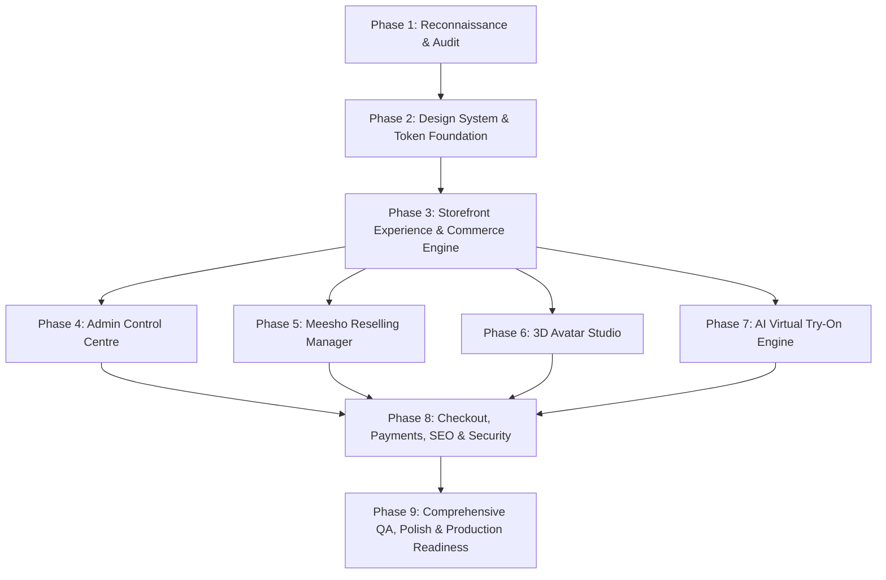

# XEVORAS — Technical Implementation Plan
**Version:** 1.0.0  
**Target Architecture:** Next.js 15 App Router · TypeScript · Prisma ORM · Three.js / React Three Fiber · Tailwind CSS & Vanilla Luxury Tokens · FASHN AI Service Provider

---

## Strategic Overview

This plan outlines the systematic phased transformation of XEVORAS into a world-class fashion-tech commerce flagship. Each phase is constructed with clear milestones, deliverables, and rigorous verification gates.

---

## Phase Matrix & Roadmap

---

## Detailed Phase Breakdown

### Phase 1: Existing Project Audit & Asset Ingestion
- [x] Mirror complete legacy live site (`https://xevoras.com`) into `legacy_site/`.
- [x] Extract all product media (36 assets), brand logos, and metadata.
- [x] Document existing architecture, data structures, and feature deficiencies (`AUDIT.md`).
- [x] Ingest high-resolution 3D embossed gold logo emblem into `public/brand/`.

### Phase 2: Design System & Frontend Foundation
- [x] UI/UX Pro Max search and design system persistence to `design-system/xevoras/MASTER.md`.
- [x] Implement luxury token architecture:
  - Color Tokens: Obsidian (`#101010`), Charcoal (`#1C1C1C`), Warm Ivory (`#F5F1E8`), Champagne Gold (`#B89560`), Stone (`#B9ADA1`), Clay (`#704B40`).
  - Typography Tokens: Playfair Display / Cormorant Garamond (Editorial Serif Display), Inter / Plus Jakarta Sans (Functional Body), Rozha One / Noto Serif Devanagari (Hindi identity).
  - Component Tokens: Button systems, pill badges, card borders, backdrop blurs, drawer transitions.
- [ ] Initialize Next.js 15 project with TypeScript, Tailwind CSS, Lucide Icons, and PostCSS.
- [ ] Implement global layouts, smooth navigation bar with bag counter, wishlist counter, search modal, and announcement bar.

### Phase 3: Complete Storefront & Customer Shopping Experience
- [ ] **Homepage Experience:**
  - Announcement bar with campaign scheduling.
  - Cinematic hero with editorial photography and dual CTA ("Explore Collection" & "Try Your Look").
  - Category horizontal chip strip and curated editorial gender tiles.
  - Dynamic "Trending Now", "New Arrivals", and "The XEVORAS Edit" showcases.
  - Interactive Style Showcase, Avatar Studio preview, and AI Try-On banner.
  - Brand story ("Quiet Luxury Meets Everyday Indian Reality"), customer reviews, Instagram grid, and newsletter subscription.
- [ ] **Catalog & Discovery (`/shop`, `/women`, `/men`):**
  - Multi-faceted filtering: Gender, Category, Size (XS–XXL), Color, Price Range, In-Stock.
  - Sorting: Price (Low/High), Newest, Bestseller.
  - Fast search modal with instant suggestions and keyword highlighting.
- [ ] **Product Detail Page (`/product/[slug]`):**
  - Multi-angle high-res image gallery with interactive pinch/zoom and thumbnail selector.
  - Variant matrix (Color and Size selection with real-time stock feedback).
  - Material, Fit, and Care tabs; interactive Size Guide modal.
  - Sticky Add to Cart drawer, Instant Buy Now, and direct "Virtual Try-On" CTA.
  - Related product recommendations and "Complete The Look" cross-sells.

### Phase 4: Admin Control Centre (`/admin`)
- [ ] Secure role-based staff authentication and session management.
- [ ] Executive KPI Dashboard: Total Revenue, Total Orders, Average Order Value (AOV), Gross Margin, Inventory Alerts.
- [ ] Product & Variant Catalog Manager:
  - Create, update, archive products.
  - Variant grid management (SKU, Size, Color, Physical Stock, On-Demand Flag).
  - Multi-image upload and CDN asset assignment.
  - Featured / New Arrival / On-Sale toggles.
- [ ] Order Processing Desk:
  - Live order search and status transitions (`confirmed` → `packed` → `shipped` → `delivered` → `returned`).
  - Shipment tracking number assignment and customer contact inspector.
- [ ] Return & Refund Management:
  - Review customer return requests, approve/reject, record reasons, and track reverse pickup.
- [ ] CMS & Storefront Settings:
  - Editable announcement bar text and promotional expiry date.
  - Hero banner headline, subtext, and background asset management.

### Phase 5: Meesho Reselling & Supplier Sourcing Manager (`/admin/reselling`)
- [ ] Distinguish two product sourcing paradigms:
  - **Owned Physical Inventory** (in-house stock, instant dispatch).
  - **Supplier-Sourced / On-Demand** (purchased from Meesho or partner workshops post-order).
- [ ] Sourcing Economics Engine:
  - Automatic Gross Margin calculation: `Selling Price - Supplier Cost - Shipping - Packaging - Platform Fees`.
  - Visual margin health indicators (Green: >35%, Amber: 20-35%, Red: <20%).
- [ ] Compliant Import Pipeline:
  - Manual supplier product entry with Supplier SKU, Source URL, wholesale cost, and approved images.
  - Batch CSV / Excel import with schema validation and duplicate SKU detection.
- [ ] Sourcing Fulfilment Workflow:
  - Orders containing on-demand items flagged for sourcing desk.
  - Status progression: `To Source` → `Purchased (Supplier Order ID)` → `Supplier Shipped` → `Received & Quality Checked` → `Dispatched to Customer`.

### Phase 6: Signature Feature — XEVORAS Avatar Studio (`/avatar-studio`)
- [ ] 3D WebGL Canvas powered by Three.js and React Three Fiber.
- [ ] Studio environment with soft studio HDR lighting, shadow plane, and orbit controls (360° rotation, smooth zoom, camera presets for Front, Side, Back, Close-up).
- [ ] Customization Parameters:
  - Gender presentation (Female / Male mannequin silhouettes).
  - Body shape presets (Slender, Athletic, Curvy, Broad).
  - Skin tone presets (Warm Ivory, Honey, Chestnut, Deep Espresso, Porcelain).
  - Height and proportion adjustments.
- [ ] Interactive Garment Rendering:
  - Garment category selector (Dresses, Shirts, Trousers, Outerwear, Co-ords).
  - Real-time outfit swapping with realistic drape, texture mapping, and material finishes.
  - Dynamic color customization for compatible garments.
- [ ] Commerce Hooks:
  - "Add Outfit to Bag" (bundles selected top and bottom into cart).
  - "Save Look" to customer profile with snapshot rendering.
  - High-fidelity Fallback Demo mode when heavy custom 3D mesh files are loading.

### Phase 7: AI Virtual Try-On Experience (`/virtual-try-on`)
- [ ] Dedicated luxury editorial interface for AI outfit previews.
- [ ] Customer Photo Upload with privacy shield:
  - Pre-upload consent modal detailing ephemeral processing and zero model retraining.
  - Client-side validation (aspect ratio, face/body visibility guide, size limits ≤10MB).
- [ ] Garment Selection:
  - Choose any eligible item from the XEVORAS catalog.
- [ ] Backend AI Provider Pipeline (`VirtualTryOnService`):
  - Server-side API handler (`/api/try-on/generate`) keeping all API keys secure.
  - Integration with FASHN AI API (Fast E-Commerce endpoint and High-Resolution Quality endpoint).
  - Provider abstraction interface allowing instant pluggability for alternative vision models (e.g. Kolors, IDM-VTON).
  - High-fidelity simulated preview fallback when API credentials are unconfigured or in demo mode.
- [ ] Interactive Result Studio:
  - Side-by-side Before/After slider comparison.
  - Download look and shareable social card.
  - Direct "Add Item to Bag" button.

### Phase 8: Checkout, Payments, Security & SEO
- [ ] Checkout flow with saved addresses, coupon engine, and Indian GST / Shipping calculation.
- [ ] Payment Provider Abstraction (`PaymentService`):
  - Standardized gateway interface supporting Razorpay / Cashfree / Stripe and Cash on Delivery (COD).
  - Secure webhook signature verification and server-side order confirmation.
- [ ] SEO Optimization:
  - Dynamic Open Graph cards, canonical URLs, `robots.txt`, and automated `sitemap.xml`.
  - JSON-LD Microdata for Google Rich Snippets (`Product`, `Organization`, `BreadcrumbList`).
- [ ] Security Hardening:
  - HTTP Security Headers (CSP, HSTS, X-Frame-Options).
  - CSRF protection, input validation via Zod schemas, and server-side authentication middleware.

### Phase 9: Quality Assurance & Production Verification
- [ ] Multi-device responsive testing across 375px (iPhone SE), 390px (iPhone 14/15), 768px (iPad Mini), 1024px (iPad Pro), and 1440px+ (Desktop).
- [ ] Accessibility audit: Contrast verification, keyboard navigation, aria labels, and `prefers-reduced-motion` compliance.
- [ ] Production Next.js build compilation, zero type errors, zero lint warnings.
